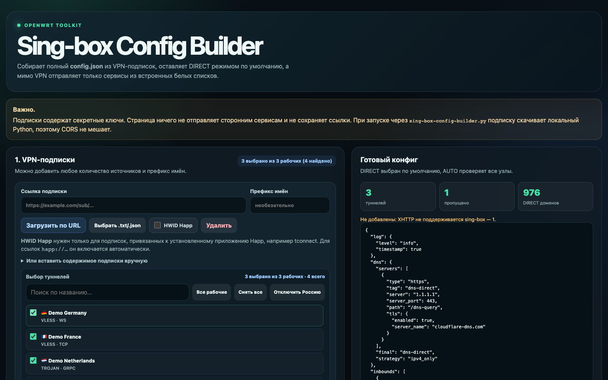
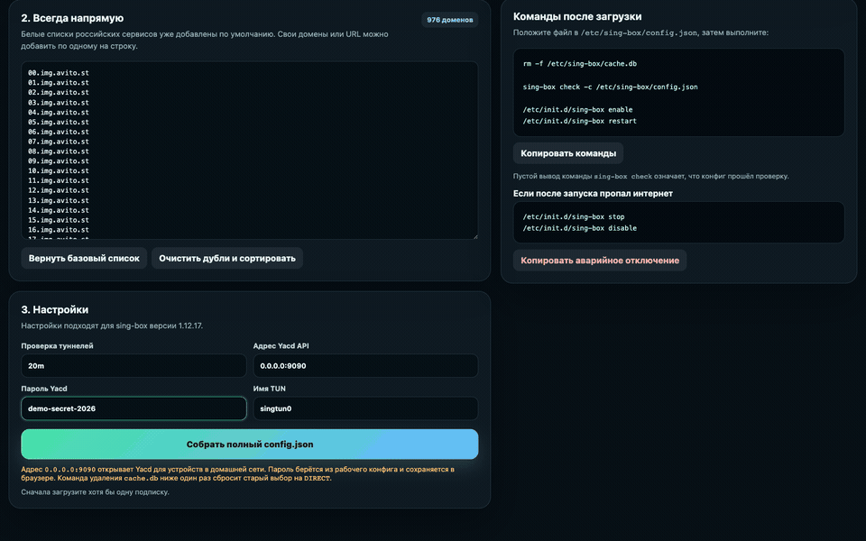
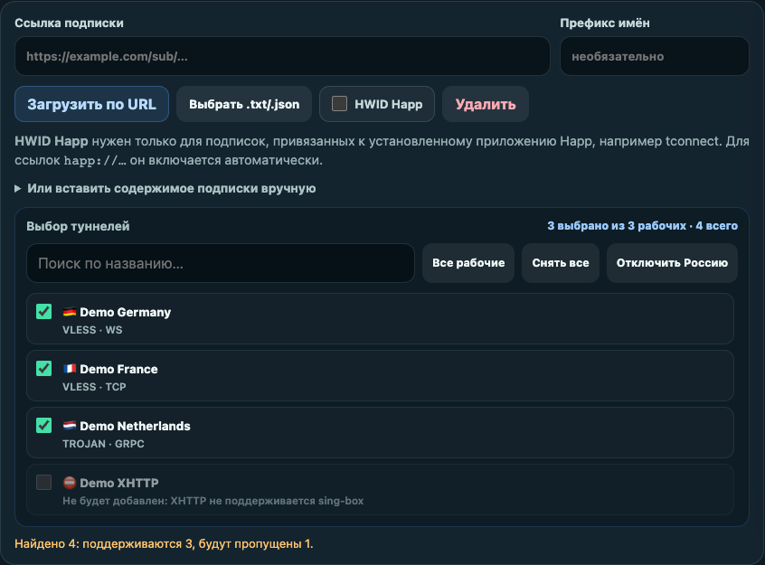
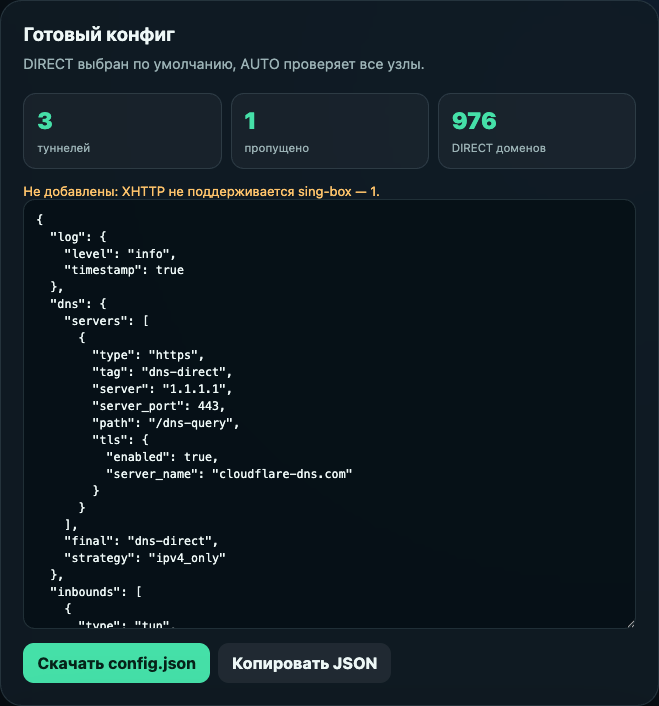

# Sing-box Config Builder

[Русский](README.md) · **English**

[](https://github.com/Pavel2232/sing-box-config-builder/actions/workflows/ci.yml)
[](LICENSE)
[](https://github.com/SagerNet/sing-box)

<p align="center">
  
</p>

<p align="center">
  A local web interface for VPN subscriptions, DIRECT routing, and building a
  complete <code>config.json</code>.
</p>

A local builder for a complete **sing-box 1.12.17** `config.json` on OpenWrt.
It loads one or more VPN subscriptions, shows every discovered node, lets you
disable unwanted tunnels, and generates a configuration with:

- `DIRECT` selected by default;
- a built-in list of Russian services that always bypass the VPN;
- `SELECT` and `AUTO` groups for Yacd;
- a TUN interface with access protection for the home network;
- VLESS, Trojan, and Hysteria2 formats supported by sing-box 1.12.17.

> [!IMPORTANT]
> Subscription URLs contain secret keys. Never publish subscription URLs,
> generated configs, or the `.happ-hwid` file.
>
> Every URL, node, and key shown in this README is fictional. No real
> subscription URL was included in the screenshots or demo.

## Quick start

Docker Compose is the recommended option:

```bash
touch sing-box-config-builder-local/.happ-hwid
docker compose up -d --build
```

Open **http://127.0.0.1:18765/en/** for English or
**http://127.0.0.1:18765/** for Russian. The container runs in the background
and restarts automatically while Docker is running.

Check its status:

```bash
docker compose ps
curl http://127.0.0.1:18765/api/health
```

Expected response: `{"ok": true}`.

Ports, Happ HWID setup, and container management are documented in
[docs/docker.md](docs/docker.md).

## Build a config



1. Add one or more subscription URLs.
2. Enable **Happ HWID** only for providers that require it.
3. Click **Load from URL** for each subscription.
4. Clear the checkboxes for unwanted or unsupported tunnels.
5. Add custom domains to **Always direct** when needed.
6. Review the Yacd address and password, `AUTO` interval, and TUN name.
7. Click **Build complete config.json** and download the file.

XHTTP/SplitHTTP nodes are not added because that transport is unavailable in
the targeted sing-box version. The exact reason is shown next to each skipped
node.

### Tunnel selection

Supported nodes can be enabled or disabled with checkboxes. Unsupported nodes
remain visible with the exact reason they were skipped.



### Generated file

After the build, the right column shows the number of tunnels, skipped nodes,
DIRECT domains, and the complete downloadable JSON.



## Happ HWID

Some subscriptions are tied to an installed Happ app. For Docker, place the
HWID as one unquoted line in:

```text
sing-box-config-builder-local/.happ-hwid
```

For regular subscriptions, the file may remain empty and the **Happ HWID**
switch must stay disabled.

## Run without Docker

The project uses only the Python 3.10+ standard library:

```bash
python3 sing-box-config-builder.py
```

Open **http://127.0.0.1:8765/en/** for English or
**http://127.0.0.1:8765/** for Russian. On macOS,
`start-sing-box-builder.command` starts the same server.

Start without opening a browser automatically:

```bash
python3 sing-box-config-builder.py --no-open
```

## Install the config on OpenWrt

Save the result as `/etc/sing-box/config.json`, then run:

```sh
rm -f /etc/sing-box/cache.db
sing-box check -c /etc/sing-box/config.json
/etc/init.d/sing-box enable
/etc/init.d/sing-box restart
```

No output from `sing-box check` means validation succeeded. If internet access
disappears after startup:

```sh
/etc/init.d/sing-box stop
/etc/init.d/sing-box disable
```

Routing, Yacd, and recovery details are available in
[docs/openwrt.md](docs/openwrt.md).

## Development

The page source is split by responsibility:

| File | Purpose |
|---|---|
| `sing-box-config-builder.template.html` | Small HTML shell |
| `src/styles.css` | Interface styles |
| `src/i18n.js` | Shared Russian and English interface translations |
| `src/parser-normalization.js` | Node field validation and normalization |
| `src/parser-transports.js` | TLS and transport conversion |
| `src/subscription-parser.js` | Subscription and protocol decoding |
| `src/source-ui.js` | Subscription loading, selection, and rendering |
| `src/app.js` | Page settings and `config.json` generation |
| `data/direct-domains.txt` | Single source of truth for DIRECT domains |
| `sing-box-config-builder.py` | Local HTTP server and safe downloads |
| `build-sing-box-config-builder.mjs` | Standalone RU/EN HTML build and compatible bundle |

After changing source files, run:

```bash
npm run build
```

Generated `sing-box-config-builder.html`, `sing-box-config-builder.en.html`,
and the files inside `sing-box-config-builder-local/` must not be edited by
hand.

Run the current non-UI test suite with:

```bash
npm test
```

Architecture and contribution details are in
[docs/development.md](docs/development.md); common failures are covered in
[docs/troubleshooting.md](docs/troubleshooting.md).

## Contributing and community

- [CONTRIBUTING.md](CONTRIBUTING.md) — local setup, change rules, and PR flow;
- [SUPPORT.md](SUPPORT.md) — where to report a bug, idea, or question;
- [SECURITY.md](SECURITY.md) — private vulnerability reporting;
- [CODE_OF_CONDUCT.md](CODE_OF_CONDUCT.md) — community standards;
- [GOVERNANCE.md](GOVERNANCE.md) — project decision making;
- [CHANGELOG.md](CHANGELOG.md) — notable changes.

Before opening an issue or pull request, remove all real subscription URLs,
keys, generated configs, and HWIDs.

## Security

- only the local Python server downloads subscriptions;
- URLs resolving to local or reserved IP addresses are blocked;
- subscription URLs and contents are never written to disk;
- Docker publishes the interface on `127.0.0.1` only;
- the container runs without root on a read-only filesystem with
  `no-new-privileges`;
- never expose the Yacd port to the public internet.

Report vulnerabilities through [SECURITY.md](SECURITY.md), not a public issue.

## License

This project is licensed under the [MIT License](LICENSE).
