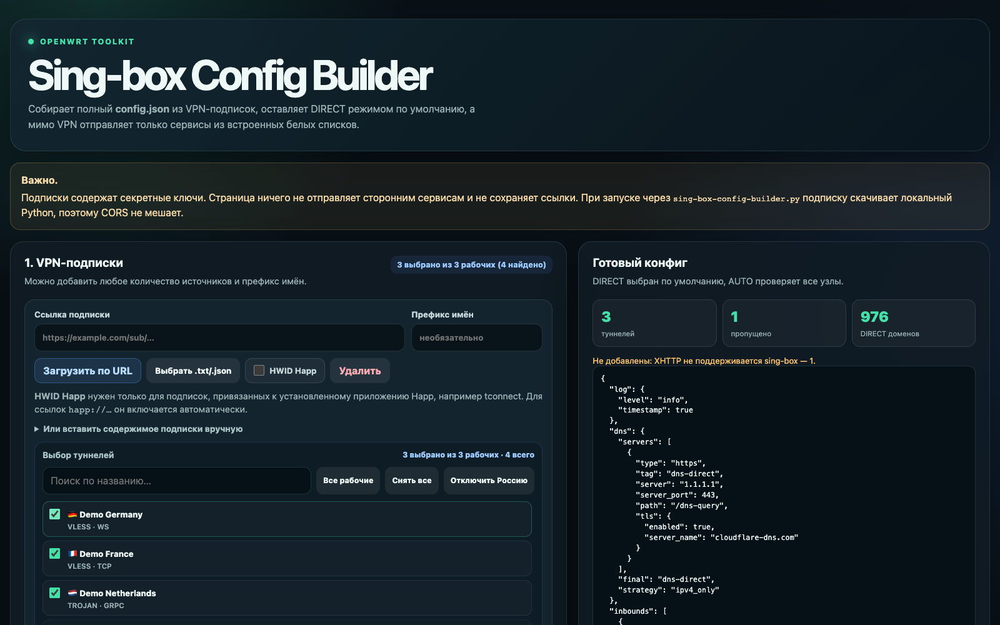
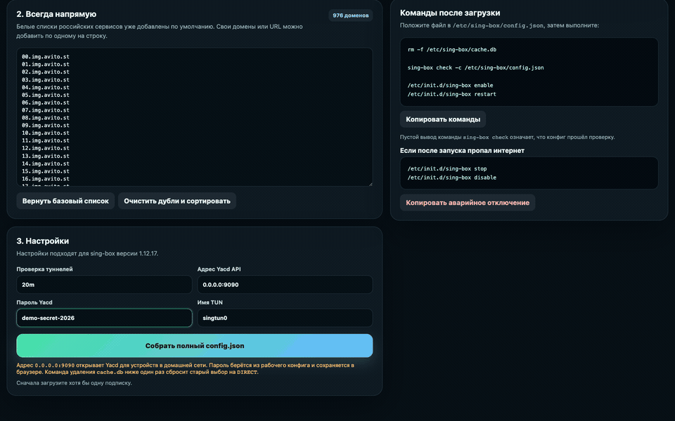
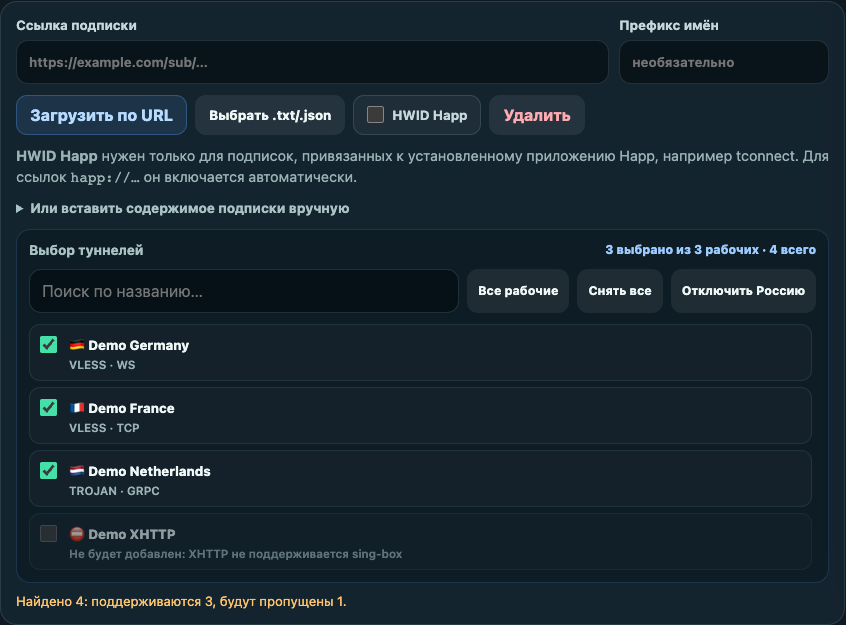
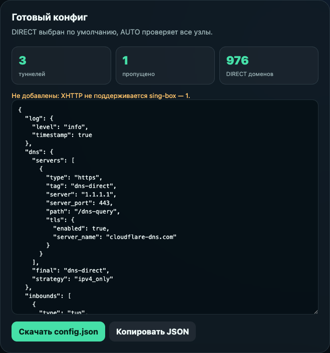

# Sing-box Config Builder

<p align="center">
  
</p>

<p align="center">
  Локальный веб-интерфейс для подписок, маршрутизации DIRECT и сборки
  готового <code>config.json</code>.
</p>

Локальный конструктор полного `config.json` для **sing-box 1.12.17** на
OpenWrt. Он загружает одну или несколько VPN-подписок, показывает найденные
узлы, позволяет отключить ненужные туннели и собирает конфигурацию с:

- `DIRECT` по умолчанию;
- встроенным списком российских сервисов, которые всегда идут напрямую;
- группами `SELECT` и `AUTO` для Yacd;
- TUN-интерфейсом и защитой доступа к домашней сети;
- VLESS, Trojan и Hysteria2 в форматах, поддерживаемых sing-box 1.12.17.

> [!IMPORTANT]
> Ссылки подписок содержат секретные ключи. Не публикуйте ссылки, готовые
> конфиги и файл `.happ-hwid`.
>
> Все URL, узлы и ключи на изображениях в этом README вымышлены. Реальные
> ссылки подписок в кадры не попадали.

## Быстрый запуск

Рекомендуемый вариант — Docker Compose:

```bash
touch sing-box-config-builder-local/.happ-hwid
docker compose up -d --build
```

Откройте **http://127.0.0.1:18765/**. Контейнер работает в фоне и
перезапускается автоматически, пока Docker запущен.

Проверка:

```bash
docker compose ps
curl http://127.0.0.1:18765/api/health
```

Ожидаемый ответ: `{"ok": true}`.

Подробности о портах, HWID и управлении контейнером находятся в
[docs/docker.md](docs/docker.md).

## Как собрать конфиг



1. Добавьте одну или несколько ссылок подписок.
2. Включайте **HWID Happ** только для провайдеров, которым он необходим.
3. Нажмите **Загрузить по URL** у каждой подписки.
4. Снимите флажки с ненужных или неподдерживаемых туннелей.
5. При необходимости дополните список **Всегда напрямую**.
6. Проверьте адрес и пароль Yacd, интервал `AUTO` и имя TUN.
7. Нажмите **Собрать полный config.json** и скачайте файл.

XHTTP/SplitHTTP не добавляются: этот транспорт отсутствует в используемой
версии sing-box. Причина пропуска отображается рядом с узлом.

### Выбор туннелей

Поддерживаемые узлы можно включать и отключать чекбоксами. Неподдерживаемые
остаются в списке с точной причиной пропуска.



### Готовый файл

После сборки справа отображаются количество туннелей, пропущенные узлы,
число DIRECT-доменов и полный JSON для скачивания.



## HWID Happ

Некоторые подписки привязаны к установленному приложению Happ. Для Docker
положите HWID одной строкой без кавычек в:

```text
sing-box-config-builder-local/.happ-hwid
```

Для обычных подписок файл может быть пустым, а переключатель **HWID Happ**
должен оставаться выключенным.

## Ручной запуск

Проект использует только стандартную библиотеку Python 3.10+:

```bash
python3 sing-box-config-builder.py
```

Страница откроется по адресу **http://127.0.0.1:8765/**. На macOS тот же
сервер запускает `start-sing-box-builder.command`.

Запуск без открытия браузера:

```bash
python3 sing-box-config-builder.py --no-open
```

## Установка на OpenWrt

Сохраните результат как `/etc/sing-box/config.json`, затем выполните:

```sh
rm -f /etc/sing-box/cache.db
sing-box check -c /etc/sing-box/config.json
/etc/init.d/sing-box enable
/etc/init.d/sing-box restart
```

Пустой вывод `sing-box check` означает успешную проверку. Если после запуска
пропал интернет:

```sh
/etc/init.d/sing-box stop
/etc/init.d/sing-box disable
```

Маршрутизация, Yacd и восстановление подробно описаны в
[docs/openwrt.md](docs/openwrt.md).

## Разработка

Исходники страницы разделены по ответственности:

| Файл | Назначение |
|---|---|
| `sing-box-config-builder.template.html` | Небольшой HTML-каркас |
| `src/styles.css` | Стили интерфейса |
| `src/parser-normalization.js` | Проверка и нормализация полей узлов |
| `src/parser-transports.js` | Преобразование TLS и транспортов |
| `src/subscription-parser.js` | Декодирование подписок и протоколов |
| `src/source-ui.js` | Загрузка, выбор и отображение источников |
| `src/app.js` | Настройки страницы и сборка `config.json` |
| `data/direct-domains.txt` | Единственный исходный список DIRECT-доменов |
| `sing-box-config-builder.py` | Локальный HTTP-сервер и безопасная загрузка |
| `build-sing-box-config-builder.mjs` | Сборка автономного HTML и совместимого bundle |

После изменения исходников выполните:

```bash
npm run build
```

Сгенерированные `sing-box-config-builder.html` и файлы внутри
`sing-box-config-builder-local/` вручную не редактируются.

Текущие тесты запускаются без браузерного/UI-раннера:

```bash
npm test
```

Архитектура и правила изменения проекта находятся в
[docs/development.md](docs/development.md), частые ошибки — в
[docs/troubleshooting.md](docs/troubleshooting.md).

## Безопасность

- подписки скачивает только локальный Python-сервер;
- URL с локальными и служебными IP блокируются;
- ссылки и содержимое подписок не записываются на диск;
- Docker публикует интерфейс только на `127.0.0.1`;
- контейнер работает без root, с read-only файловой системой и
  `no-new-privileges`;
- порт Yacd нельзя публиковать в интернет.

## Лицензия

Проект распространяется по лицензии [MIT](LICENSE).
